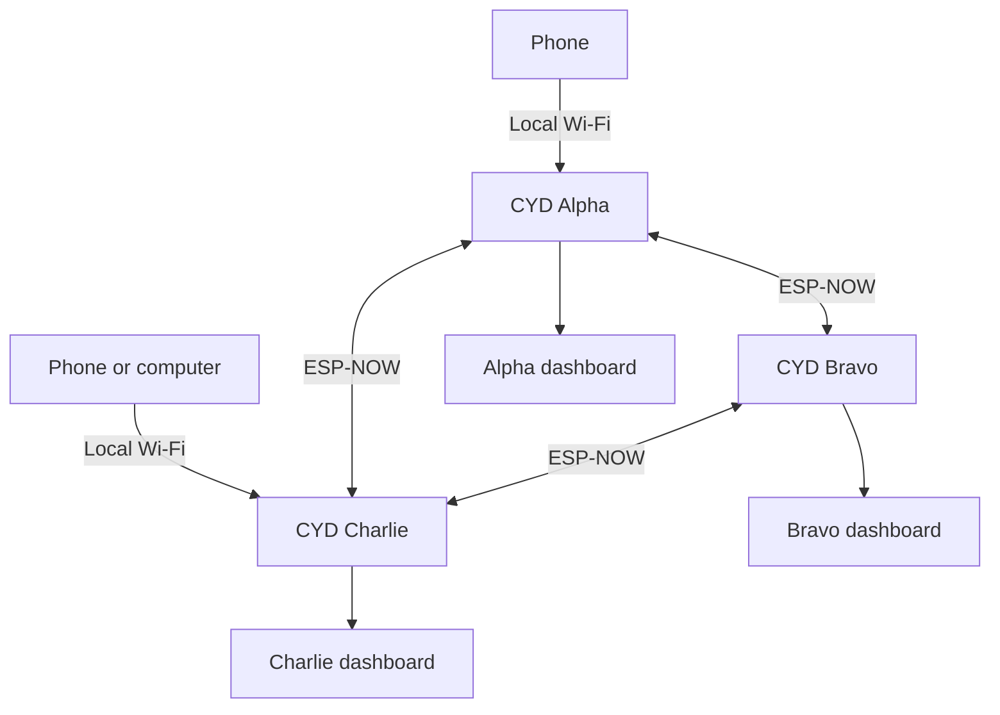
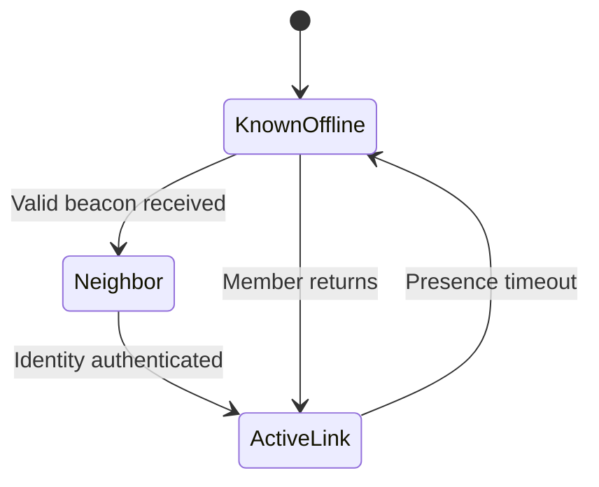
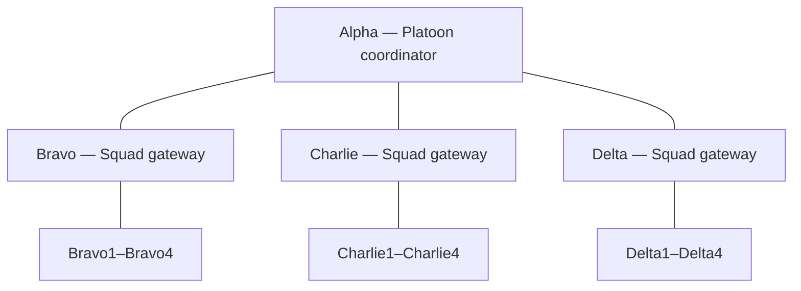
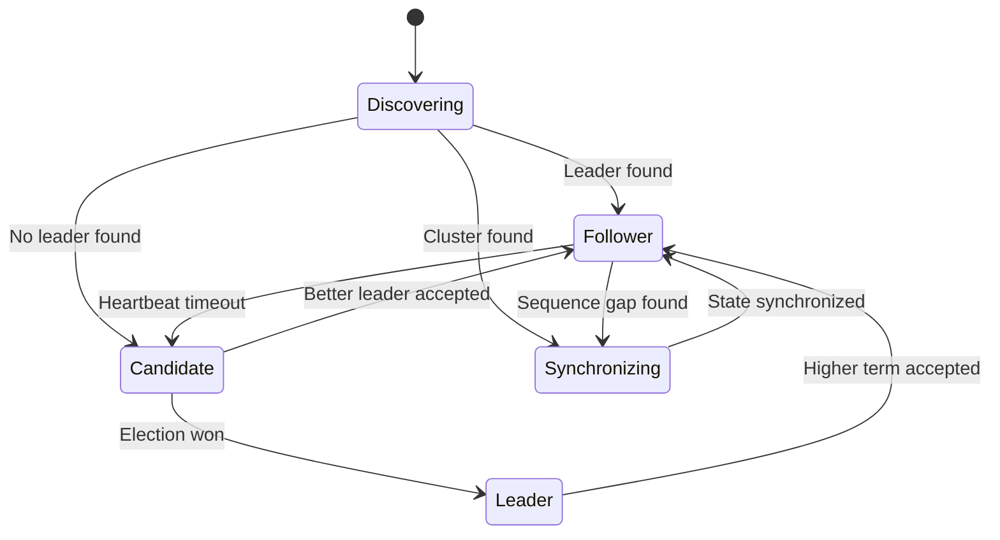
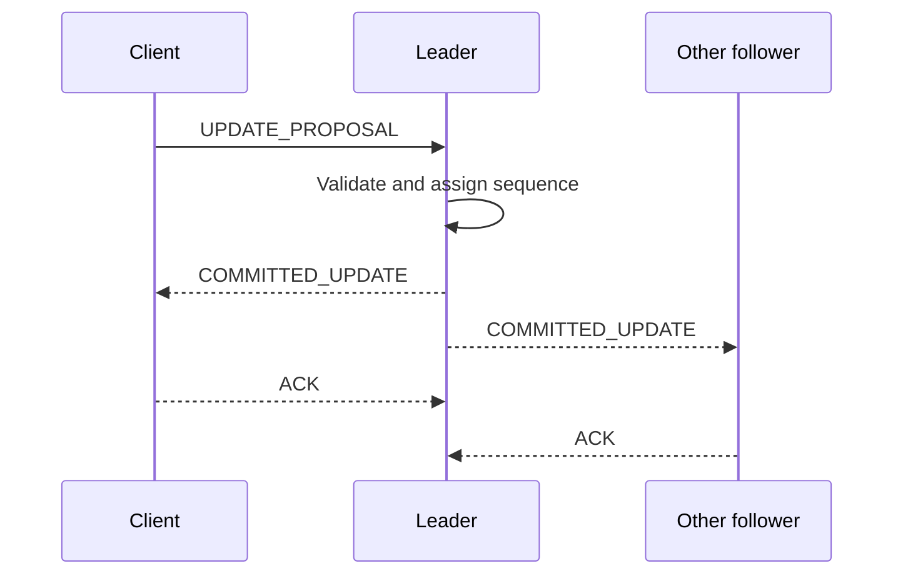
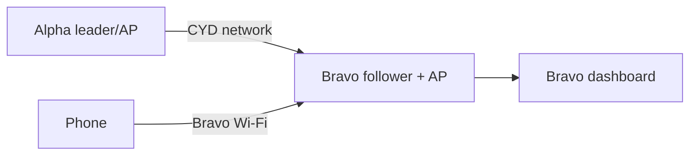
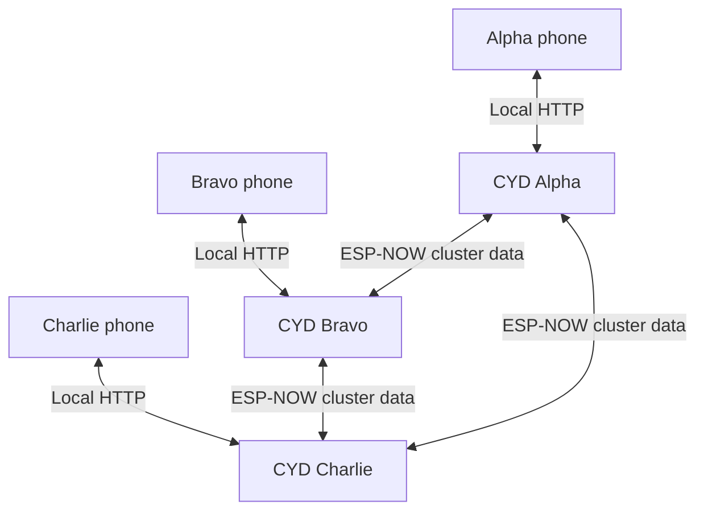
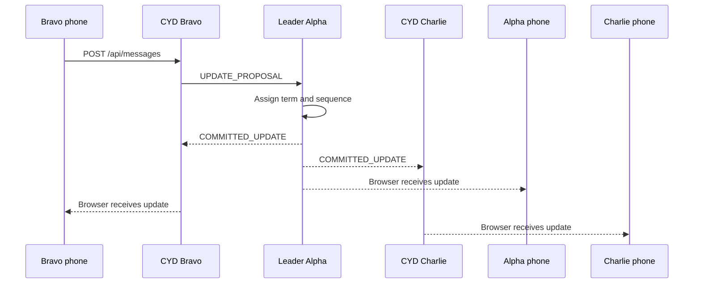

# CYD Mesh

## Distributed ESP32 Network Project Plan

**Working title:** CYD Mesh  
**Concept:** A *Division*-inspired, self-organizing network of Cheap Yellow Display ESP32 devices that discover one another, share data, elect a coordinator, and automatically recover when that coordinator disappears.

## Vision

Three CYD devices should behave like independent nodes in a resilient local network:

- Any two nearby devices automatically discover one another.
- One becomes the leader/coordinator; the other becomes a follower.
- When a third device arrives, it joins as another follower.
- The leader coordinates shared data and assigns message sequence numbers.
- Every node keeps a replicated copy of important shared state.
- If the leader leaves, loses power, or moves out of range, the remaining nodes elect a replacement.
- When an old leader returns, it synchronizes and rejoins without unnecessarily replacing the active leader.
- Each CYD can expose its own Wi-Fi access point and browser dashboard for a nearby phone or computer.

The result should feel like a small field network: autonomous nodes, visible roles, shared intelligence, and graceful failover.

## Primary demonstration

The first successful demonstration should be visually simple but technically meaningful:

1. Power on Alpha and Bravo.
2. The devices discover one another.
3. Alpha becomes leader and Bravo becomes follower.
4. Power on Charlie.
5. Charlie joins the existing cluster as a follower.
6. Press a button on any CYD to increment a shared counter or create a short message.
7. All three screens display the same state.
8. Power off Alpha.
9. Bravo and Charlie detect the missing heartbeat and elect Bravo.
10. The shared state remains available.
11. Power Alpha back on.
12. Alpha rejoins as a follower and synchronizes with Bravo.

Example display:

```text
CYD MESH — BRAVO

ROLE: LEADER
TERM: 7
SEQUENCE: 148

ALPHA     OFFLINE
BRAVO     LEADER
CHARLIE   CONNECTED

NETWORK: SYNCHRONIZED
```

## Recommended technical approach

Use **ESP-NOW** as the primary CYD-to-CYD communication system.

ESP-NOW is appropriate because it:

- Allows direct ESP32-to-ESP32 communication.
- Does not require an existing Wi-Fi access point.
- Supports broadcast discovery.
- Supports unicast peer communication.
- Has low overhead and low latency.
- Can operate through either the station or Soft-AP Wi-Fi interface.
- Supports encrypted unicast communication when peer keys are configured.

The elected “server” should initially be an **application-level leader**, not a conventional Wi-Fi server or router. Every node runs the same firmware and can assume any role.

## High-level architecture



Every node contains:

- ESP-NOW discovery and messaging
- Leader-election state machine
- Peer table
- Shared replicated state
- TFT interface
- Local HTTP dashboard
- Optional Soft-AP for a phone or computer
- Optional SD/LittleFS persistence

## Device identities

Each CYD should have a permanent node identity stored in configuration.

| Node | Display name | Suggested priority | Suggested AP subnet |
|---|---|---:|---|
| CYD 1 | Alpha | 100 | `192.168.4.1/24` |
| CYD 2 | Bravo | 90 | `192.168.5.1/24` |
| CYD 3 | Charlie | 80 | `192.168.6.1/24` |

The numeric node ID should remain stable across reboots. It can be derived from the station MAC address or explicitly configured.

```cpp
struct NodeIdentity {
  uint32_t networkId;
  uint32_t nodeId;
  char name[16];
  uint8_t priority;
};
```

`networkId` prevents unrelated CYD Mesh installations from joining one another.

## Durable membership and temporary neighbors

The network must distinguish **who belongs to the team** from **who is currently within radio range**. Moving out of range, losing power, or restarting must never revoke a device's membership.

| Concept | Meaning | Expected lifetime |
|---|---|---|
| Team member | An authorized device identity in the permanent roster | Until explicitly enrolled, revoked, or replaced |
| ESP-NOW peer | A MAC address and optional link key loaded for direct transmission | Operational state; it may need to be rebuilt after restart |
| Neighbor | A recognized member currently reachable by radio | Temporary; determined from authenticated beacons and timeouts |
| Route | The presently preferred path to a destination | Disposable; recalculated whenever topology changes |

The permanent roster should be stored in NVS, LittleFS, or another nonvolatile store. For the proposed 16-device platoon, every CYD can retain the complete roster even though it communicates directly with only its current neighbors.

```cpp
struct MemberRecord {
  uint32_t nodeId;
  uint32_t parentId;
  uint8_t role;
  uint8_t enabled;
  uint8_t stationMac[6];
  uint8_t publicKeyFingerprint[16];
  char name[16];
};

struct NeighborRecord {
  uint32_t nodeId;
  uint32_t bootId;
  uint32_t lastSeenMs;
  int8_t rssi;
  uint8_t stationMac[6];
  bool authenticated;
};
```

A member that times out is removed from the live neighbor table, but not from the permanent roster. When a valid beacon is heard again, communication resumes automatically without a user repeating enrollment or pairing.

### Authenticated rediscovery

Each device should periodically broadcast a small presence beacon containing:

- Protocol version and network ID
- Permanent node ID
- Current boot ID
- Monotonically increasing beacon sequence
- Role and capabilities
- Current Wi-Fi channel
- Random nonce
- HMAC or digital signature

The receiving node should:

1. Reject the beacon if the network or protocol version is wrong.
2. Look up the claimed node ID in its permanent roster.
3. Verify the HMAC or signature; a MAC address alone is not proof of identity.
4. Add or refresh the temporary neighbor record.
5. Add or update the ESP-NOW peer entry when direct unicast is required.
6. Exchange synchronization summaries and resume queued traffic.



ESP-NOW peer configuration should be treated as reconstructable runtime state. At startup, firmware loads identity, roster, and credentials from persistent storage; initializes Wi-Fi and ESP-NOW on the platoon's fixed channel; restores required peer entries; then broadcasts its authenticated presence.

### Organization is not topology

A device's assigned organization and its current route must remain independent.

```text
Assigned organization: Bravo2 belongs to Bravo Squad
Current radio route:   Bravo2 is temporarily reachable through Charlie
```

If Bravo2 loses contact with Bravo but encounters Charlie, Charlie may relay its traffic without changing Bravo2's permanent assignment. This permits opportunistic recovery while retaining a stable platoon roster.

## Platoon and squad routing model

The first large-network model is a hierarchical, multi-hop, store-and-forward tree:



Initial routing rules:

- Alpha routes `Bravo*`, `Charlie*`, and `Delta*` traffic through the corresponding squad gateway.
- Each squad gateway directly serves its four assigned members and sends other destinations upward to Alpha.
- Each subordinate uses its squad gateway as the default route.
- A directly encountered authenticated member may become a temporary alternate next hop.
- Organizational leadership and radio-routing responsibility are separate concepts; the best available relay need not be the organizational leader.

Example path when Bravo2 and Charlie3 cannot hear one another:

```text
Bravo2 -> Bravo -> Alpha -> Charlie -> Charlie3
```

The message envelope must distinguish the original sender and final destination from the previous and next radio hops. It should also carry a globally unique message ID, priority, hop limit, creation time, expiration time, and delivery state.

Suggested addressing scopes:

| Scope | Routing behavior |
|---|---|
| Individual | Deliver to one final node |
| Squad | Gateway distributes to its assigned members |
| Squad leaders | Alpha distributes to Bravo, Charlie, and Delta |
| Platoon | Alpha fans out once per squad; gateways distribute locally |
| Emergency | High-priority forwarding with controlled retry and expiration |

Platoon broadcasts should be hierarchical rather than Alpha transmitting separately to every subordinate. This reduces airtime and permits a squad gateway to store traffic for temporarily unavailable members.

### Store-and-forward and reconnection

Every relay retains a queued message until the next hop acknowledges it or the message expires. End-to-end delivery acknowledgments return to the origin independently of hop-level radio success.

Recommended message states:

- `QUEUED`
- `RELAYED`
- `DELIVERED`
- `READ`
- `EXPIRED`
- `FAILED`

After two devices reconnect, they exchange synchronization summaries containing the most recent committed sequence, pending message IDs, and acknowledgments. Missing traffic is retransmitted; already-seen message IDs are discarded as duplicates.

If a gateway or Alpha is unavailable, isolated devices continue local squad operation and retain outbound traffic. Election can replace a failed coordinator only when the replacement is physically able to reach the required groups. A new leader cannot overcome a radio partition by election alone.

## Network roles

```cpp
enum class NodeRole : uint8_t {
  Discovering,
  Follower,
  Candidate,
  Leader,
  Synchronizing
};
```

### Discovering

- Broadcasts a `HELLO` message.
- Builds a list of nearby compatible nodes.
- Listens for an established leader.
- Joins the leader if one is active.
- Starts an election if no leader is discovered.

### Follower

- Listens for leader heartbeats.
- Sends proposed updates to the leader.
- Applies sequenced updates broadcast by the leader.
- Maintains a synchronized copy of shared state.
- Starts an election when the leader is considered unavailable.

### Candidate

- Participates in a leadership election.
- Advertises its term, priority, and node ID.
- Becomes leader if it wins.
- Returns to follower if it sees a better valid candidate or leader.

### Leader

- Broadcasts regular heartbeats.
- Assigns monotonically increasing sequence numbers to accepted updates.
- Broadcasts committed updates.
- Responds to synchronization requests.
- Does not own the only copy of important data.

### Synchronizing

- Has joined or rejoined the network.
- Requests missing updates or a current snapshot.
- Does not propose normal writes until synchronized.
- Becomes a follower when caught up.

## State transitions



## Leader-election rules

Use a deterministic election rule so all nodes select the same winner:

1. Highest election term wins.
2. If terms are equal, highest configured priority wins.
3. If priorities are equal, lowest numeric node ID wins.

The election should not depend on which message happens to arrive first.

Suggested timing:

| Behavior | Starting value |
|---|---:|
| Leader heartbeat interval | 1,000 ms |
| Suspect leader after | 3 missed heartbeats |
| Election delay | Random 250–750 ms |
| Discovery window at startup | 2,000 ms |
| Peer stale timeout | 10,000 ms |

The randomized election delay reduces simultaneous leadership declarations.

### Returning leader behavior

A returning node should not automatically reclaim leadership merely because it has a higher configured priority.

Preferred rule:

> A healthy established leader remains leader until it fails, voluntarily steps down, or a node presents a strictly higher election term.

This prevents repeated leadership changes whenever a previously disconnected device reappears.

## Split-brain handling

A split-brain condition occurs when two separated groups both believe they have a leader.

With only three nodes, a sophisticated consensus protocol is unnecessary for the first version, but every leadership message must contain:

- Network ID
- Election term
- Leader node ID
- Leader priority
- Latest committed sequence

When two groups reconnect:

1. Higher term wins.
2. If terms match, the deterministic priority/node-ID rule chooses the winner.
3. The losing leader steps down.
4. Nodes compare committed sequence numbers.
5. Conflicting writes are resolved according to the selected conflict policy.

The first version can use last-write-wins for noncritical demonstration data. More rigorous conflict resolution can be added later.

## Message envelope

All ESP-NOW messages should share a common header.

```cpp
enum class MessageType : uint8_t {
  Hello,
  PresenceBeacon,
  PeerStatus,
  Heartbeat,
  Election,
  LeaderAnnouncement,
  UpdateProposal,
  CommittedUpdate,
  Acknowledgment,
  SyncRequest,
  SyncResponse,
  Snapshot,
  RoutedMessage,
  DeliveryReceipt,
  RouteAdvertisement,
  Ping,
  Pong
};

struct MessageHeader {
  uint16_t protocolVersion;
  uint16_t messageType;
  uint32_t networkId;
  uint32_t senderId;
  uint32_t originId;
  uint32_t destinationId;
  uint32_t messageId;
  uint32_t bootId;
  uint32_t term;
  uint32_t sequence;
  uint16_t payloadLength;
  uint8_t priority;
  uint8_t hopsRemaining;
  uint16_t checksum;
};
```

`bootId` should be a random number generated at startup. It distinguishes a rebooted instance of a node from delayed packets sent before the reboot.

Keep initial messages below 250 bytes for broad ESP-NOW compatibility, even when the installed ESP-NOW version supports larger frames.

## Discovery message

```cpp
struct HelloPayload {
  uint8_t priority;
  uint8_t role;
  uint8_t wifiChannel;
  uint8_t reserved;
  uint32_t lastCommittedSequence;
  char nodeName[16];
};
```

Each node periodically broadcasts `HELLO` while discovering. An established leader can respond with a `LEADER_ANNOUNCEMENT` containing the current term and sequence.

## Leader heartbeat

```cpp
struct HeartbeatPayload {
  uint32_t leaderId;
  uint32_t leaderUptime;
  uint32_t committedSequence;
  uint8_t connectedNodeCount;
};
```

Followers should track both the last heartbeat time and the last committed sequence advertised by the leader.

## Shared data and replication

The leader coordinates data but must not be the only device storing it.



Example committed update:

```cpp
struct DataUpdate {
  uint32_t term;
  uint32_t sequence;
  uint32_t originNodeId;
  uint16_t dataType;
  uint16_t payloadLength;
  uint8_t payload[192];
};
```

For the first demonstration, shared data can contain:

- A network-wide counter
- Short text messages
- Node presence information
- Button events
- Selected status or color

## Synchronization

A joining node includes its last committed sequence in its `HELLO` message.

If it is only slightly behind:

```text
SYNC_REQUEST
Node: Alpha
Last sequence: 42
```

The leader sends updates 43 through the current sequence.

If the node is far behind or the leader no longer retains the missing updates, the leader sends a complete snapshot.

```cpp
struct SyncRequestPayload {
  uint32_t lastCommittedSequence;
  bool acceptsSnapshot;
};
```

The first version can keep a small circular history of committed updates plus a current snapshot.

## AP+STA phone access

An ESP32 can operate as both a Wi-Fi station and a Soft-AP:

```cpp
WiFi.mode(WIFI_AP_STA);
```

A CYD can therefore communicate with another CYD while simultaneously providing a local Wi-Fi network for a phone.



Example:

| Interface | Address | Purpose |
|---|---|---|
| Alpha network/AP | `192.168.4.1` | Alpha local access |
| Bravo station side | `192.168.4.2` | Bravo connection toward Alpha, if conventional Wi-Fi is used |
| Bravo Soft-AP | `192.168.5.1` | Phone access to Bravo |
| Phone | `192.168.5.2` | Dashboard client |

### Critical subnet rule

Do not use `192.168.4.1/24` for every CYD access point. A device operating in AP+STA mode must not use the same subnet on both interfaces.

Suggested assignments:

```text
Alpha:   192.168.4.1/24
Bravo:   192.168.5.1/24
Charlie: 192.168.6.1/24
```

### Single-radio limitation

Each CYD has one 2.4 GHz Wi-Fi radio. Its AP, station, and ESP-NOW activity share that radio and must use a compatible channel.

For this project:

- Configure one fixed ESP-NOW/Wi-Fi channel for all nodes.
- Keep messages small.
- Avoid large file transfers while testing elections.
- Expect phone-dashboard activity to share airtime with cluster messages.

Three nodes exchanging status data should be well within practical limits.

## Phone-to-phone data exchange

The phones do not need direct routes to one another. Each phone communicates only with the CYD whose Wi-Fi network it has joined. The CYDs relay and replicate the application data.



Each CYD serves the same local web application:

```text
Alpha phone:   http://192.168.4.1/
Bravo phone:   http://192.168.5.1/
Charlie phone: http://192.168.6.1/
```

The page can provide text messaging, shared status, mission/task data, peer presence, and cluster diagnostics without Internet access.

### Message flow

When Bravo's phone submits a message:



The local CYD accepts the browser request, converts it into a cluster update proposal, and sends it to the leader. The leader assigns the official sequence number and distributes the committed message. Every CYD stores the committed message in its replicated history, allowing every local web page to show the same conversation.

### Suggested phone message

```cpp
struct PhoneMessagePayload {
  uint32_t messageId;
  uint32_t senderSessionId;
  char senderName[24];
  char text[160];
};
```

The enclosing cluster message supplies the term, committed sequence, origin node, and protocol metadata.

### Browser application versus native application

A separate Android application is not required for the initial implementation. A locally served HTML/CSS/JavaScript application is the preferred MVP because it:

- Requires no installation.
- Works on phones, tablets, and computers.
- Can be updated by replacing files on the CYD.
- Communicates with the local CYD using ordinary HTTP and JSON.
- Remains available with no Internet connection.

A native application becomes useful later if the project needs:

- Background notifications while the browser is closed.
- Operation while the phone screen is off.
- Camera, microphone, GPS, Bluetooth, or local-file integration.
- More control over Android's Wi-Fi-versus-cellular behavior.
- Encrypted local storage.
- Automatic CYD discovery and reconnection.

### Browser update strategy

Use browser polling for the first version. Each page requests committed messages after its last known sequence number:

```javascript
setInterval(async () => {
  const response = await fetch(`/api/messages?after=${lastSequence}`);
  const messages = await response.json();
  displayMessages(messages);
}, 1000);
```

Polling is compatible with the standard Arduino `WebServer`, automatically recovers from brief failures, and is adequate for three phones exchanging short messages.

Possible later upgrades:

1. Server-Sent Events for one-way CYD-to-browser updates.
2. WebSockets for persistent two-way real-time communication.

### Behavior during leader failure

Each phone remains connected to its local CYD while the CYDs elect a new leader. The browser can show a temporary state:

```text
Leader connection lost.
Electing a new coordinator...

Bravo is now the network leader.
Messages synchronized through sequence 149.
```

Messages submitted during the election should either be queued locally with a visible `Pending` state or rejected with a clear retry response. The first version should reject and ask the browser to retry; local queuing can be added later.

If Bravo and Charlie use conventional Wi-Fi station connections to Alpha, Alpha's loss also destroys their upstream Wi-Fi network. They would need to reconfigure around the new leader. Using ESP-NOW for cluster traffic avoids that dependency: each phone-facing Soft-AP can remain active while the CYDs elect a replacement independently.

### Phone behavior without Internet

Phones may report that the CYD Wi-Fi network has no Internet access. Android users may need to select **Stay connected** or **Use this network anyway**. The local page remains reachable through the CYD's numeric address.

Plain HTTP is appropriate for the isolated MVP. A normal publicly trusted HTTPS certificate will not be available for private numeric addresses. Security should instead begin with strong Wi-Fi passwords, ESP-NOW peer encryption for sensitive cluster data, and an application login or pairing code if required.

## Dashboard strategy

Every CYD should host the same dashboard regardless of role. A phone can connect to the nearest or most convenient device without knowing which node is leader.

The local CYD should answer cluster queries from its replicated state. It should not forward every dashboard request to the leader.

Suggested endpoints:

| Route | Purpose |
|---|---|
| `/` | Cluster dashboard |
| `/api/node` | Local node identity, role, term, and uptime |
| `/api/cluster` | Known nodes and current leader |
| `/api/state` | Current replicated state |
| `/api/events` | Recent discovery, election, and synchronization events |
| `/api/messages?after={sequence}` | Committed phone messages after a sequence number |
| `/api/messages` | Submit a message through the local CYD |
| `/api/propose` | Propose a state update through the local node |
| `/api/ping` | Basic phone-to-node health check |

If a follower receives a proposed update from its dashboard, it sends an `UPDATE_PROPOSAL` to the leader and waits for the committed update.

## TFT interface

### Main status view

```text
CYD MESH — CHARLIE

FOLLOWER       TERM 7
LEADER: BRAVO
SYNC: 148 / 148

ALPHA     OFFLINE
BRAVO     LEADER
CHARLIE   FOLLOWER
```

### Election view

```text
LEADER SIGNAL LOST

ELECTION STARTING
TERM 8

BRAVO     CANDIDATE
CHARLIE   CANDIDATE
```

### Synchronization view

```text
ALPHA RECONNECTED

REQUESTING UPDATES
LOCAL: 122
CLUSTER: 148
```

Use color sparingly:

- Orange: leader/network identity
- Cyan: normal synchronization
- Yellow: election or degraded state
- Red: lost node or failed send
- Green: committed update or synchronized state

## Security

ESP-NOW broadcast discovery is suitable for non-sensitive presence messages. Sensitive data should use encrypted unicast peers.

Recommended rules:

- Give every installation a unique `networkId`.
- Reject messages from other network IDs.
- Include a protocol version in every message.
- Add a checksum or message authentication mechanism.
- Use ESP-NOW PMK/LMK encryption for unicast data.
- Do not place secrets in broadcast discovery packets.
- Use strong, distinct passwords for CYD Soft-AP dashboards.
- Consider a dashboard login or pairing code.
- Reject stale terms and obviously replayed sequence numbers.
- Store the authorized membership roster and credentials in nonvolatile storage.
- Authenticate discovery beacons; do not trust a claimed node ID or MAC address by itself.
- Prefer per-device credentials and revocation for the mature design. A shared team key is acceptable only as an understood prototype tradeoff.
- Remember that ESP-NOW link encryption protects one radio hop. Add application-level end-to-end encryption if intermediate relays must route a message without reading its contents.

## Reliability rules

- Never perform heavy display, storage, or network work inside ESP-NOW callbacks.
- Copy received packets into a FreeRTOS queue.
- Process state transitions in the main application task.
- Avoid unbounded `String` growth.
- Use fixed-size peer, event, and update buffers.
- Persist critical identity separately from temporary cluster state.
- Use wrap-safe `millis()` comparisons.
- Include a boot ID so delayed packets from a previous boot can be rejected.
- Rate-limit repeated discovery and election messages.
- Never delete a member from the permanent roster merely because its presence timer expired.
- Use globally unique message IDs, duplicate suppression, hop limits, expiration times, hop acknowledgments, and end-to-end delivery receipts.
- Persist important outbound queues and acknowledgment state if messages must survive a device restart.

## Suggested source layout

```text
CYD-Mesh/
├── CYD-Mesh.ino
├── Config.h
├── NodeIdentity.h
├── MeshProtocol.h
├── PeerTable.h
├── PeerTable.cpp
├── ElectionManager.h
├── ElectionManager.cpp
├── ReplicatedState.h
├── ReplicatedState.cpp
├── EspNowTransport.h
├── EspNowTransport.cpp
├── DashboardServer.h
├── DashboardServer.cpp
├── DisplayController.h
├── DisplayController.cpp
└── web/
    ├── index.html
    ├── styles.css
    └── app.js
```

Start with a single `.ino` sketch for discovery and basic election. Split the project only when the protocol is working.

## Phased implementation plan

### Phase 1 — Hardware identity and display

- Flash the same basic sketch to all three devices.
- Assign Alpha, Bravo, and Charlie identities.
- Display MAC address, node ID, and node name.
- Configure all devices to use the same fixed Wi-Fi channel.

**Exit condition:** each CYD shows a stable unique identity.

### Phase 2 — ESP-NOW discovery

- Initialize ESP-NOW.
- Broadcast `HELLO` messages.
- Receive and validate peer messages.
- Maintain an in-memory peer table.
- Show nearby nodes and last-seen times on the TFT.

**Exit condition:** powering devices on and off updates every visible peer list.

### Phase 3 — Static deterministic leader

- Elect the highest-priority visible node.
- Display leader and follower roles.
- Do not implement terms or failover timing yet.

**Exit condition:** all visible nodes independently agree on the same leader.

### Phase 4 — Heartbeats and failover

- Have the leader broadcast heartbeats.
- Detect missed heartbeats.
- Add randomized election delays.
- Introduce election terms.
- Announce and accept the winner.

**Exit condition:** powering off the leader causes exactly one remaining node to become leader.

### Phase 5 — Shared counter

- Add an `UPDATE_PROPOSAL` message.
- Let a physical button propose a counter increment.
- Have the leader sequence and commit the update.
- Replicate the value to all nodes.

**Exit condition:** a button on any node changes the counter on every node.

### Phase 6 — State recovery

- Keep recent committed updates.
- Add `SYNC_REQUEST` and `SYNC_RESPONSE`.
- Add full-state snapshot fallback.
- Rejoin a powered-off node and catch it up.

**Exit condition:** a returning node reaches the current state without resetting the cluster.

### Phase 7 — Per-node Wi-Fi dashboard

- Enable AP+STA mode as needed.
- Give each node its own SSID and subnet.
- Serve the same dashboard from every node.
- Display local and replicated cluster state.
- Let dashboard actions propose updates.
- Add a browser-based text conversation view.
- Add `POST /api/messages` for phone-originated messages.
- Add `GET /api/messages?after={sequence}` for polling.
- Show pending, committed, and temporarily unavailable states.
- Keep every phone connected to its local CYD during leader elections.

**Exit condition:** a phone can connect to any node, view the same cluster state, and exchange committed text messages with phones attached to the other CYDs.

### Phase 8 — Encryption and persistence

- Add unicast peer encryption.
- Persist node identity and configuration.
- Optionally persist the latest snapshot.
- Add protocol-version checks and defensive validation.

**Exit condition:** nodes securely re-form the cluster after a complete power cycle.

### Phase 9 — Durable roster and automatic rediscovery

- Separate persistent membership, ESP-NOW peer state, neighbor presence, and route state.
- Persist the authorized roster and device credentials.
- Authenticate presence beacons.
- Rebuild ESP-NOW peer entries after restart.
- Mark absent nodes offline without revoking them.
- Resume synchronization and queued delivery automatically when a known member returns.

**Exit condition:** two devices can move out of range, restart if desired, and later resume authenticated communication without manual re-pairing.

### Phase 10 — Platoon routing

- Configure Alpha plus Bravo, Charlie, and Delta squad gateways.
- Add hierarchical logical addresses and next-hop routing.
- Forward a direct message across multiple hops.
- Add squad and platoon distribution scopes.
- Add hop acknowledgments, end-to-end receipts, queues, expiration, and duplicate suppression.
- Permit a recognized member to use an authenticated temporary alternate relay.

**Exit condition:** Bravo2 can exchange messages with Charlie3 through Bravo, Alpha, and Charlie despite having no direct radio contact.

## First coding session checklist

1. Create a new `CYD-Mesh` project.
2. Record the installed ESP32 Arduino core version.
3. Confirm all three CYDs use compatible hardware and display configuration.
4. Create one shared firmware with configurable node identity.
5. Select one fixed ESP-NOW channel.
6. Display the local station and AP MAC addresses.
7. Implement a small `HELLO` packet below 250 bytes.
8. Broadcast once per second.
9. Queue received messages outside the ESP-NOW callback.
10. Display discovered peers and last-seen ages.
11. Test with two devices first.
12. Add the third device only after two-way discovery is stable.
13. Do not implement the dashboard, encryption, or replication during the first session.

## Initial acceptance tests

### Discovery

- [ ] Alpha discovers Bravo.
- [ ] Bravo discovers Alpha.
- [ ] Charlie can join later.
- [ ] Duplicate `HELLO` packets update rather than duplicate peers.
- [ ] A missing node becomes stale and then offline.
- [ ] An offline node remains in the authorized team roster.
- [ ] A known node automatically resumes communication when it returns to range.
- [ ] Restarting a node rebuilds its required ESP-NOW peer state from persistent configuration.
- [ ] A spoofed or unauthorized beacon is rejected.

### Election

- [ ] All nodes agree on the leader.
- [ ] Leader emits regular heartbeats.
- [ ] Followers do not start elections while heartbeats arrive.
- [ ] One replacement leader is selected after failure.
- [ ] A returning old leader joins without disrupting a healthy leader.
- [ ] A higher term forces an outdated leader to step down.

### Replication

- [ ] Updates from any follower reach the leader.
- [ ] Leader assigns one sequence number per accepted update.
- [ ] Every online node applies committed updates in order.
- [ ] Sequence gaps trigger synchronization.
- [ ] Returning nodes catch up.

### Phone access

- [ ] Every node exposes its own unique SSID.
- [ ] AP and station interfaces use different subnets.
- [ ] Dashboard is available on the local AP address.
- [ ] Phone access does not interrupt ESP-NOW heartbeats.
- [ ] Dashboard shows local role and shared cluster state.
- [ ] A message submitted through Bravo appears on Alpha and Charlie.
- [ ] Every phone displays the same committed message sequence.
- [ ] Refreshing a page restores the replicated conversation.
- [ ] A leader election leaves all three local dashboards reachable.
- [ ] The page reports election/retry status instead of silently losing a message.
- [ ] Android can remain connected after warning that Internet is unavailable.

### Multi-hop routing

- [ ] Bravo2 can send to Charlie3 through Bravo, Alpha, and Charlie.
- [ ] Each relay suppresses duplicate message IDs.
- [ ] A hop limit prevents indefinite forwarding loops.
- [ ] A squad gateway queues a message while its subordinate is unavailable.
- [ ] Queued delivery resumes automatically after the subordinate returns.
- [ ] The origin receives an end-to-end delivery receipt.
- [ ] A platoon broadcast fans out once per squad rather than once per subordinate.
- [ ] Bravo2 can temporarily route through Charlie without changing its Bravo Squad assignment.

## Known challenges

| Challenge | Initial strategy |
|---|---|
| All Wi-Fi functions share one radio | Fix every node to the same channel and keep traffic small. |
| Simultaneous leader declarations | Randomized election delay plus deterministic tie-breaking. |
| Old leader returns | Existing healthy leader remains leader. |
| Data lost with leader | Replicate committed state to every node. |
| Node misses updates | Sequence numbers and sync requests. |
| Network partition creates two leaders | Reconcile by term, priority, and node ID when networks rejoin. |
| Broadcast messages are not encrypted | Broadcast only discovery metadata; encrypt sensitive unicast data. |
| Callback concurrency | Queue packets and process them in the application task. |
| AP subnet collisions | Assign a distinct subnet to each CYD. |
| ESP-NOW version differences | Keep baseline packets at or below 250 bytes. |
| Radio range changes constantly | Keep durable membership separate from temporary neighbor and route tables. |
| Device restarts lose runtime peer state | Rebuild ESP-NOW peer entries from persisted roster and credentials. |
| MAC address spoofing | Authenticate beacons with a shared prototype key or per-device credentials. |
| Relay disappears mid-delivery | Queue, retry with backoff, expire cleanly, and search for an alternate route. |
| Central coordinator cannot bridge a physical partition | Continue local operation and store traffic until a viable route returns. |

## Possible future features

- Touchscreen network map
- Directional or distance-like display based on RSSI
- Encrypted text-message exchange
- Shared mission/task list
- File or image transfer in numbered chunks
- Location labels manually assigned to each CYD
- Store-and-forward messages when a peer returns
- Phone dashboard with a cluster topology view
- Browser-based group and direct text conversations
- Native Android companion application for background notifications
- Audible or visual alert when a node disappears
- Election replay visualization
- Battery-powered operation and sleep-aware leadership
- Fourth and fifth nodes
- Gateway node that optionally bridges selected data to a home server
- Log export to SD card
- Over-the-air configuration distribution

## Definition of a successful first release

The first release is successful when:

- Three CYDs automatically discover one another.
- All three agree on one leader.
- Followers detect leader loss and elect a replacement.
- A returning node rejoins without disrupting the active leader.
- A shared counter or message state remains consistent across all online nodes.
- A returning node synchronizes missing state.
- Each TFT clearly displays node identity, role, leader, term, peers, and synchronization status.

Phone dashboards and encrypted traffic are valuable extensions, but they should not delay the first working distributed cluster.

## Reference documentation

- [Arduino-ESP32 ESP-NOW API](https://docs.espressif.com/projects/arduino-esp32/en/latest/api/espnow.html)
- [Espressif ESP-NOW Programming Guide](https://docs.espressif.com/projects/esp-idf/en/latest/esp32/api-reference/network/esp_now.html)
- [Arduino-ESP32 Wi-Fi API](https://docs.espressif.com/projects/arduino-esp32/en/latest/api/wifi.html)
