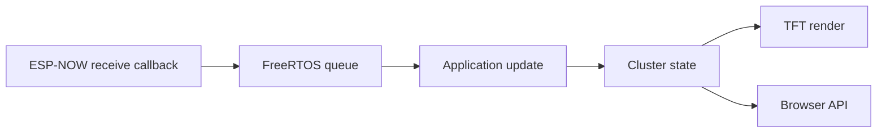
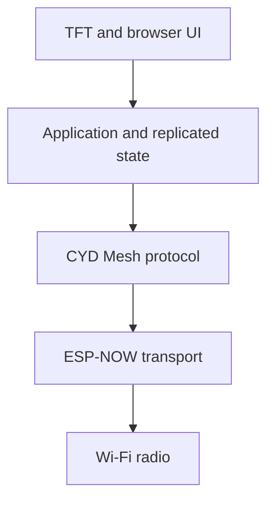
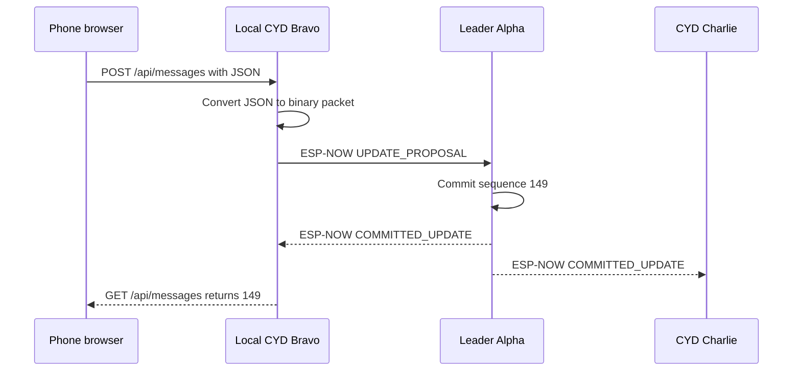

# ESP-NOW for Web UI Developers

## A practical mental model for the CYD Mesh project

ESP-NOW is easier to understand if you temporarily stop thinking about Wi-Fi as “the thing that gives a browser an IP address.”

ESP-NOW uses the ESP32's Wi-Fi radio, but it does not require:

- A router
- An access point
- DHCP
- DNS
- IP addresses
- TCP
- HTTP
- A cloud service

It lets ESP32 devices send small messages directly to one another using Wi-Fi radio frames.

For a web developer, the closest mental model is:

> ESP-NOW is like a tiny local event bus running directly between devices, below the normal web stack.

## The web stack you already know

A familiar browser application looks roughly like this:


You normally think in terms of:

- URLs
- Routes
- JSON
- Requests and responses
- WebSockets
- Authentication
- Server state
- Browser state
- Error responses

The networking layers underneath HTTP are mostly invisible.

## The ESP-NOW stack

ESP-NOW removes most of those layers:


There is no URL such as:

```text
http://alpha.local/api/messages
```

Instead, your code says something conceptually closer to:

```text
Send these 84 bytes to the ESP32 with this MAC address.
```

The receiving ESP32 gets a callback containing:

- The sender's MAC address
- A pointer to the received bytes
- The number of bytes received
- Radio metadata supplied by the API

Your application decides what those bytes mean.

## Web-to-ESP-NOW translation table

| Web development concept | ESP-NOW equivalent |
|---|---|
| Server hostname | Peer MAC address or application node ID |
| URL route | Message type field |
| HTTP request body | Packet payload |
| JSON schema | C/C++ message struct or serialized format |
| HTTP method | Message command/type |
| WebSocket message | ESP-NOW packet |
| Event listener | Receive callback |
| HTTP status code | Application acknowledgment/error message |
| Request ID | Message ID |
| Server sequence | Cluster sequence number |
| Session ID | Boot ID or sender-session ID |
| API version | Protocol version |
| Authentication token | Shared key, pairing state, or signed message |
| Retry middleware | Application retry timer |
| Database replication | Replicated state on each CYD |
| Load balancer/leader | Elected coordinator node |
| Service discovery | Broadcast `HELLO` messages |
| Health check | Heartbeat message |
| Offline cache | Local replicated state |

## ESP-NOW is not a web server

ESP-NOW does not expose endpoints. It delivers messages.

In a web application, you might write:

```javascript
await fetch('/api/counter', {
  method: 'POST',
  headers: { 'Content-Type': 'application/json' },
  body: JSON.stringify({ increment: 1 })
});
```

With ESP-NOW, the equivalent idea is represented as a packet:

```cpp
enum class MessageType : uint8_t {
  IncrementCounter = 1
};

struct IncrementCounterMessage {
  uint16_t protocolVersion;
  MessageType type;
  uint32_t senderId;
  uint32_t messageId;
  int32_t increment;
};
```

Then the bytes of that struct are sent to a peer.

The receiving node does the equivalent of route handling:

```cpp
void handleMessage(const uint8_t* data, size_t length) {
  if (length < sizeof(MessageHeader)) return;

  const MessageHeader* header =
      reinterpret_cast<const MessageHeader*>(data);

  switch (header->messageType) {
    case MessageType::Hello:
      handleHello(data, length);
      break;

    case MessageType::Heartbeat:
      handleHeartbeat(data, length);
      break;

    case MessageType::UpdateProposal:
      handleUpdateProposal(data, length);
      break;
  }
}
```

That `switch` statement is playing the role that a router plays in an Express, ASP.NET, or React Router application.

## MAC addresses instead of IP addresses

Normal web traffic is delivered using IP addresses. ESP-NOW delivers directly to Wi-Fi interfaces identified by MAC addresses.

Example MAC address:

```text
F4:12:FA:40:64:4C
```

An ESP32 may have different MAC addresses for its station and Soft-AP interfaces. The selected address must match the interface used for ESP-NOW communication.

For application logic, avoid spreading raw MAC addresses throughout the code. Create a stable node abstraction:

```cpp
struct Peer {
  uint32_t nodeId;
  uint8_t mac[6];
  char name[16];
  unsigned long lastSeenAt;
};
```

The transport layer uses the MAC address. The UI and business logic use names such as Alpha, Bravo, and Charlie.

This is similar to keeping database IDs out of presentation code.

## Broadcast versus unicast

ESP-NOW supports two important communication patterns.

### Broadcast

A broadcast message is sent to every compatible listening ESP32 on the same channel.

Web analogy:

> A public event published on a local event bus where every subscriber may receive it.

Good uses:

- `HELLO`
- “Is there an active leader?”
- Leader heartbeats
- Election announcements
- Non-sensitive presence information

Broadcast is useful before the sender knows the peers' individual addresses.

### Unicast

A unicast message targets one specific peer MAC address.

Web analogy:

> Sending a request to one known service instance or a direct WebSocket client.

Good uses:

- Update proposal sent to the leader
- Synchronization response to one node
- Acknowledgment
- Direct message
- Sensitive application data

Encrypted ESP-NOW communication applies to paired unicast peers. Broadcast/multicast ESP-NOW frames are not encrypted by the ESP-NOW peer-key mechanism.

## The Wi-Fi channel is like a shared room

Every participating node must listen on the same Wi-Fi channel.

Think of the channel as a physical meeting room:

- Alpha is speaking in room 6.
- Bravo is listening in room 6.
- Charlie is listening in room 1.
- Charlie hears nothing, even though it is nearby.

For CYD Mesh, configure one fixed channel for the entire cluster:

```cpp
constexpr uint8_t meshChannel = 6;
```

If a CYD also connects to a conventional Wi-Fi access point, that connection can force the radio onto the access point's channel. The ESP-NOW design must account for that. Using one agreed channel across ESP-NOW and phone-facing Soft-AP behavior avoids many confusing failures.

## Messages are bytes, not objects

JavaScript allows flexible runtime objects:

```javascript
const message = {
  type: 'heartbeat',
  leaderId: 100,
  term: 7,
  sequence: 148
};
```

ESP-NOW sends a byte buffer. You must decide how to transform application data into bytes.

Common choices:

1. Fixed C/C++ structs
2. JSON text
3. CBOR or MessagePack
4. Protocol Buffers or another binary schema
5. A custom type-length-value format

### Fixed structs

Advantages:

- Fast
- Compact
- Predictable memory use
- Simple on identical ESP32 firmware

Disadvantages:

- Struct packing and alignment matter.
- Version changes require care.
- Variable-length data is less convenient.
- Unsafe casts can break when packet lengths are not validated.

### JSON

Advantages:

- Familiar to web developers
- Easy to inspect over Serial
- Flexible while prototyping

Disadvantages:

- Larger messages
- More parsing work
- More heap use
- Easier to exceed safe packet sizes
- Dynamic allocation can fragment memory

For CYD Mesh, use compact fixed headers and bounded payloads. JSON can still be useful at the HTTP boundary between a phone browser and its local CYD.


The CYD acts as a translator between web-friendly JSON and radio-friendly binary messages.

## Create an API contract anyway

The lack of HTTP does not eliminate API design. It makes a clear protocol contract more important.

Every message should begin with a common header:

```cpp
struct MessageHeader {
  uint16_t protocolVersion;
  uint16_t messageType;
  uint32_t networkId;
  uint32_t senderId;
  uint32_t bootId;
  uint32_t term;
  uint32_t sequence;
  uint32_t messageId;
  uint16_t payloadLength;
  uint16_t checksum;
};
```

This is comparable to the metadata in an HTTP request:

| Header field | Purpose |
|---|---|
| `protocolVersion` | Reject incompatible firmware/protocol versions |
| `messageType` | Route the message to the correct handler |
| `networkId` | Reject unrelated nearby clusters |
| `senderId` | Identify the logical node |
| `bootId` | Distinguish the current boot from old delayed packets |
| `term` | Reject messages from obsolete leaders |
| `sequence` | Order committed updates |
| `messageId` | Detect duplicates and match acknowledgments |
| `payloadLength` | Validate the packet before reading its body |
| `checksum` | Detect malformed or corrupted application data |

## Callbacks are event handlers

The ESP-NOW receive callback will feel familiar to a UI developer:

```javascript
button.addEventListener('click', handleClick);
socket.addEventListener('message', handleMessage);
```

ESP-NOW uses the same broad pattern:

```cpp
void onDataReceived(
    const esp_now_recv_info_t* info,
    const uint8_t* data,
    int length) {
  // A packet arrived.
}
```

But there is an embedded-systems rule:

> The callback should capture the event, not perform the entire application workflow.

Do not do heavy work inside the callback:

- Do not redraw the entire TFT.
- Do not write large records to the SD card.
- Do not build a large HTML response.
- Do not block while waiting for something else.
- Do not mutate complex shared state without synchronization.

Copy a small validated packet into a queue, then process it in the main application task.



This resembles a UI event handler dispatching an action to a state store instead of directly rewriting every DOM element.

## Delivery callbacks are not business acknowledgments

ESP-NOW can report whether a frame was delivered at the radio/MAC layer. That does not necessarily mean:

- The receiving application accepted it.
- The message passed validation.
- The leader committed the update.
- The state was saved.
- Other nodes received it.

Web analogy:

> A successful TCP write is not the same as receiving `200 OK` from the application.

CYD Mesh should define its own acknowledgment messages:

```cpp
struct AcknowledgmentPayload {
  uint32_t acknowledgedMessageId;
  uint32_t committedSequence;
  uint16_t resultCode;
};
```

Possible result codes:

```cpp
enum class ResultCode : uint16_t {
  Accepted,
  Committed,
  Duplicate,
  WrongLeader,
  StaleTerm,
  InvalidPayload,
  Busy
};
```

## ESP-NOW is naturally message-oriented

HTTP often encourages request/response thinking:

```text
Request -> Response -> Done
```

ESP-NOW works better when treated as asynchronous messaging:

```text
Send proposal
Continue running
Receive acknowledgment later
Receive committed update later
Update the display
```

This resembles Redux actions, browser events, queues, or WebSocket messages more than synchronous controller calls.

## There is no automatic request-response pairing

If Alpha sends a request to Bravo, ESP-NOW does not automatically create a promise or awaitable response.

Your application must include a message ID:

```cpp
uint32_t nextMessageId();
```

And maintain pending operations:

```cpp
struct PendingRequest {
  uint32_t messageId;
  uint32_t destinationNodeId;
  unsigned long sentAt;
  uint8_t retryCount;
};
```

When an acknowledgment arrives, the application matches its `acknowledgedMessageId` to the pending request.

This is comparable to correlation IDs in asynchronous APIs.

## Reliability is your responsibility

ESP-NOW is not a transactional message broker. Your application should expect:

- A packet may not arrive.
- An acknowledgment may not arrive.
- A node may restart.
- A duplicate packet may arrive after a retry.
- Messages can be observed in an unexpected order.
- A node can leave while an operation is pending.

Use the same defensive ideas used in distributed web systems:

- Unique message IDs
- Idempotent handlers
- Retry limits
- Exponential or randomized backoff
- Sequence numbers
- Timeouts
- Duplicate detection
- Protocol versions
- Explicit error messages

### Idempotency example

This message is dangerous to retry blindly:

```json
{ "action": "incrementCounter" }
```

If the leader receives it twice, the counter might increment twice.

Add an idempotency key:

```json
{
  "messageId": 92841,
  "action": "incrementCounter"
}
```

The leader records recently processed message IDs and ignores duplicates.

That is the same principle as an idempotency key in a payment API.

## State belongs above the transport

Do not let ESP-NOW callbacks become the application's state model.

Use layers:



### Transport layer

Responsible for:

- Initializing ESP-NOW
- Registering peers
- Sending bytes
- Receiving bytes
- Reporting send completion
- Recording signal/radio metadata

### Protocol layer

Responsible for:

- Validating headers
- Routing message types
- Version checks
- Acknowledgments
- Retry policy
- Duplicate detection

### Application layer

Responsible for:

- Leader election
- Peer presence
- Replicated state
- Chat messages
- Shared counters
- Synchronization

### Presentation layer

Responsible for:

- TFT screens
- Browser JSON endpoints
- HTML/CSS/JavaScript dashboard
- User interaction

This separation will feel natural if you already separate React components, Redux state, API clients, and domain logic.

## Leader election in web terms

The CYD Mesh leader is not necessarily a “server” in the hardware sense. Every device runs the same code. Leadership is temporary application state.

Web analogy:

> Three identical service instances are running. One holds a renewable coordinator lease. If it stops sending lease heartbeats, the remaining instances select a replacement.

The leader:

- Sends heartbeats
- Assigns committed sequence numbers
- Resolves update ordering
- Provides synchronization data

Followers:

- Monitor the heartbeat
- Propose changes
- Apply committed updates
- Retain replicated state
- Become candidates if the leader disappears

## Replication in UI terms

Think of every CYD as maintaining its own Redux-like store:

```javascript
const clusterState = {
  leaderId: 100,
  term: 7,
  committedSequence: 148,
  peers: [],
  messages: [],
  sharedCounter: 42
};
```

The leader sends ordered committed actions:

```javascript
{
  type: 'MESSAGE_COMMITTED',
  sequence: 149,
  payload: {
    sender: 'Bravo Phone',
    text: 'Meet at the north gate.'
  }
}
```

Every node reduces the same ordered action into its local state. If all nodes begin from the same snapshot and apply the same committed actions in the same order, their state stays consistent.

This is conceptually similar to event sourcing.

## Phone browser plus ESP-NOW

The phone does not speak ESP-NOW. Its browser speaks ordinary HTTP to its local CYD.



The CYD is an adapter between two worlds:

| Phone side | CYD cluster side |
|---|---|
| HTTP | ESP-NOW |
| JSON | Binary structs |
| IP address | MAC address/node ID |
| Browser polling | Asynchronous packets |
| HTTP response | Application acknowledgment |

## Packet size

ESP-NOW v1 supports payloads up to 250 bytes. ESP-NOW v2 can support packets up to 1,470 bytes, but behavior depends on the ESP-IDF/Arduino core and peer versions.

For the first CYD Mesh protocol:

- Keep every baseline packet at or below 250 bytes.
- Split longer content into numbered chunks.
- Include transfer ID, chunk index, and total chunk count.
- Acknowledge important chunks.
- Set a maximum message or file size.

Example chunk header:

```cpp
struct ChunkPayload {
  uint32_t transferId;
  uint16_t chunkIndex;
  uint16_t chunkCount;
  uint16_t dataLength;
  uint8_t data[180];
};
```

Do not begin the project with file transfer. Get discovery, heartbeats, election, and small committed messages working first.

## Peer registration

ESP-NOW maintains a peer list for targeted sending. Conceptually, peer registration is similar to creating a configured API client:

```javascript
const alphaClient = new ApiClient({ baseUrl: 'https://alpha' });
```

In ESP-NOW, the configuration includes:

- MAC address
- Wi-Fi channel
- Wi-Fi interface
- Optional Local Master Key for encryption

Broadcast discovery can identify a new node. The application can then add that node as a unicast peer.

## Encryption mental model

ESP-NOW supports a Primary Master Key and per-peer Local Master Keys for encrypted unicast traffic.

Think of it as transport-level encryption between paired devices—not a complete identity, authorization, or application-security system.

You still need application rules:

- Is this the correct `networkId`?
- Is this sender a known member?
- Is this message type allowed from this role?
- Is the term current?
- Is the sequence plausible?
- Has the message already been processed?

Encryption protects content in transit. It does not make malformed or unauthorized application commands safe.

## ESP-NOW and normal Wi-Fi can coexist

An ESP32 can use ESP-NOW while also operating as a Soft-AP or station. The important constraint is the single radio and shared channel.

In CYD Mesh:

- ESP-NOW carries CYD-to-CYD cluster messages.
- The Soft-AP lets a phone connect to its local CYD.
- The HTTP server serves the local dashboard.
- All radio activity shares the same 2.4 GHz hardware.

Avoid treating the phone-facing Wi-Fi connection as the cluster's only transport. If the leader's access point disappears, followers would lose the network needed to elect a replacement. ESP-NOW provides the independent peer channel needed for resilient failover.

## What ESP-NOW does not provide

ESP-NOW does not automatically provide:

- A mesh-routing algorithm
- Leader election
- Replicated state
- Guaranteed ordered delivery
- Unlimited packet history
- Persistent storage
- HTTP or JSON parsing
- Device-friendly names
- Automatic application acknowledgments
- Conflict resolution
- File transfer
- A browser interface

ESP-NOW is the transport primitive. CYD Mesh supplies the distributed-system behavior above it.

## Common mistakes for web developers

### Treating send success as a committed operation

Radio delivery is not equivalent to an application-level success response.

### Building a huge JSON protocol immediately

JSON is convenient but consumes scarce packet space and memory. Use it at the browser boundary; use compact packets between CYDs.

### Doing all work in callbacks

Callbacks should enqueue data. Application logic should run elsewhere.

### Forgetting duplicate messages

Retries can cause the receiver to see the same logical operation more than once.

### Assuming message order

Use explicit terms and sequence numbers instead of arrival order.

### Ignoring channel configuration

Peers on different Wi-Fi channels cannot exchange ESP-NOW messages even if the code and MAC addresses are correct.

### Using dynamic memory everywhere

Desktop and browser applications can tolerate extensive allocation. Long-running embedded systems benefit from fixed buffers and bounded collections.

### Combining transport, state, and UI

Keep ESP-NOW code separate from cluster logic and screen rendering.

## A minimal learning progression

### Exercise 1 — Broadcast “Hello”

- Alpha broadcasts its node name once per second.
- Bravo prints the message to Serial.
- No leader election yet.

Learn:

- Initialization
- Channel selection
- Broadcast peer
- Receive callback

### Exercise 2 — Two-way unicast

- Bravo learns Alpha's MAC.
- Bravo sends a direct `PING`.
- Alpha returns `PONG`.

Learn:

- Peer registration
- Unicast sending
- Message IDs
- Application acknowledgments

### Exercise 3 — Peer list

- Add Charlie.
- Every node tracks name, ID, MAC, and last-seen time.
- Display the peer list on the TFT.

Learn:

- Broadcast discovery
- Bounded peer tables
- Timeout-based presence

### Exercise 4 — Heartbeat

- Elect Alpha statically.
- Alpha broadcasts heartbeats.
- Followers display heartbeat age.

Learn:

- Timers
- Liveness
- Shared protocol header

### Exercise 5 — Failover

- Turn off Alpha.
- Bravo and Charlie run an election.
- One becomes leader.

Learn:

- Terms
- Randomized delays
- Deterministic tie-breaking

### Exercise 6 — Replicated counter

- Press a button on any CYD.
- The leader commits an increment.
- Every CYD displays the same value.

Learn:

- Proposals
- Committed sequence
- Idempotency
- Replication

### Exercise 7 — Phone webpage

- Connect a phone to Bravo's Soft-AP.
- Open Bravo's local page.
- Submit a counter update or text message.
- Observe it on all CYDs.

Learn:

- HTTP-to-ESP-NOW translation
- Browser polling
- Presentation/state separation

## Debugging checklist

When a message does not arrive, check in this order:

1. Are both devices powered and running the expected firmware?
2. Are both devices using the same Wi-Fi channel?
3. Is ESP-NOW initialized after Wi-Fi starts?
4. Is the correct station/AP MAC address being used?
5. Is the broadcast or unicast peer registered correctly?
6. Is the selected Wi-Fi interface enabled?
7. Is the packet within the supported size?
8. Does the receiver validate the same protocol version and network ID?
9. Is the receive callback firing?
10. Is the callback successfully placing the message in the queue?
11. Is the main application task draining the queue?
12. Is a stale term, duplicate ID, or checksum check rejecting the packet?

Log transport and application outcomes separately:

```text
TX radio success: message 92841 to Alpha
RX ACK: message 92841 accepted
RX COMMIT: message 92841 committed as sequence 149
```

Those are three different facts.

## Terms to remember

| Term | Plain-language meaning |
|---|---|
| Peer | Another ESP32 that can exchange ESP-NOW packets |
| MAC address | Hardware/interface address used to deliver the packet |
| Channel | Radio frequency slot all participating devices must share |
| Broadcast | Send to every listening node on the channel |
| Unicast | Send to one specific peer |
| Callback | Function invoked when sending or receiving completes |
| PMK | Primary Master Key used by ESP-NOW security configuration |
| LMK | Per-peer Local Master Key for encrypted unicast traffic |
| Payload | Application bytes carried inside the packet |
| Term | Leadership generation used to reject obsolete leaders |
| Sequence | Ordered number assigned to committed cluster updates |
| Heartbeat | Periodic message proving the leader is still active |
| Snapshot | Complete copy of current replicated state |

## The shortest useful summary

If you remember only five things:

1. ESP-NOW sends small byte messages directly between ESP32 radios without IP or a router.
2. A receive callback is like an event listener, but it should enqueue work rather than perform it.
3. MAC addresses and message types replace hostnames and URL routes.
4. Delivery, retries, acknowledgments, ordering, leadership, and replication are application responsibilities.
5. In CYD Mesh, the phone uses HTTP/JSON with its local CYD; the CYDs use ESP-NOW packets with one another.

## Official references

- [Arduino-ESP32 ESP-NOW API](https://docs.espressif.com/projects/arduino-esp32/en/latest/api/espnow.html)
- [Espressif ESP-NOW Programming Guide](https://docs.espressif.com/projects/esp-idf/en/latest/esp32/api-reference/network/esp_now.html)
- [Arduino-ESP32 Wi-Fi API](https://docs.espressif.com/projects/arduino-esp32/en/latest/api/wifi.html)

