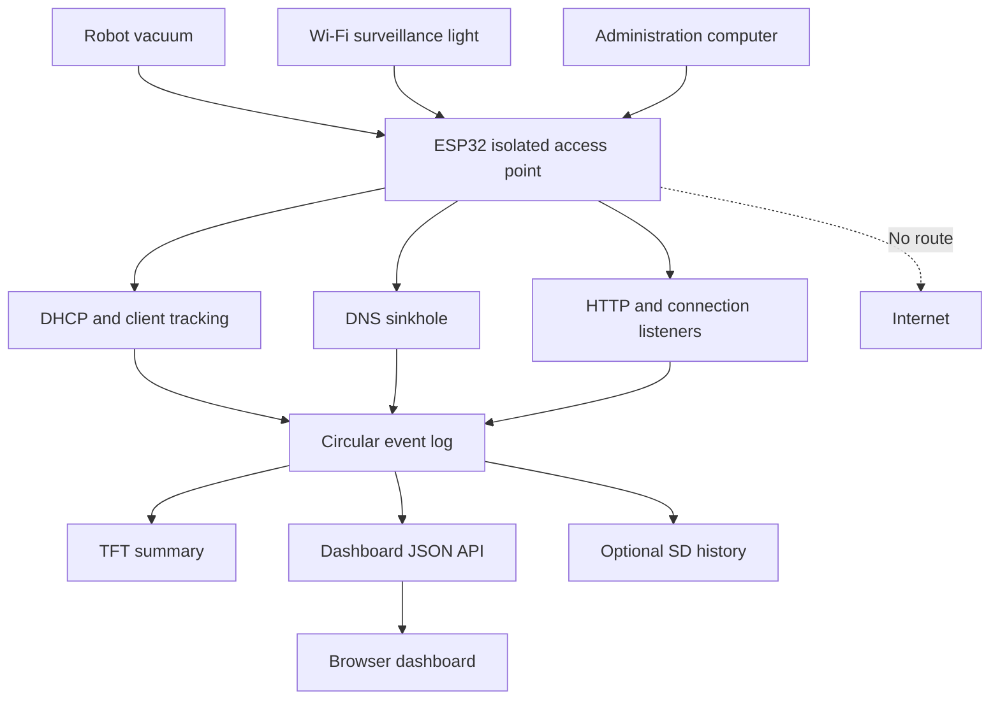
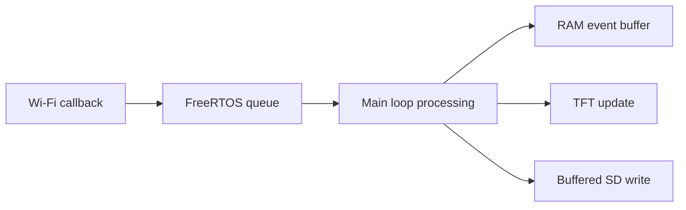

# ESP32 Isolated IoT Traffic Monitor

## Project purpose

Build an isolated Wi-Fi access point on an ESP32 that lets household IoT devices connect without receiving Internet access. The ESP32 will record what each device attempts to contact and present the results on its TFT display and through a browser dashboard.

The initial targets are devices such as:

- Robot vacuums
- Wi-Fi surveillance lights
- Smart plugs, bulbs, cameras, and similar IoT equipment

The existing `CYD-DocumentServer.ino` sketch is the starting point. It already provides:

- ESP32 Wi-Fi station mode
- Soft-AP fallback mode
- An HTTP server
- TFT status output
- SD card and LittleFS support
- File upload, download, browsing, and deletion
- A rolling on-screen event log

## Primary goal

Answer questions such as:

- Which domains does this device try to resolve?
- Which IP addresses and ports does it try to contact?
- How frequently does it retry?
- Does it use HTTP, HTTPS, MQTT, NTP, STUN, or another protocol?
- Does it make requests while apparently idle?
- Does it attempt to contact multiple vendors or third parties?
- Does it continue functioning without Internet access?

## Non-goals for the first version

- Providing Internet access to connected devices
- Acting as a production home router
- Decrypting HTTPS or other TLS traffic
- Bypassing certificate validation or certificate pinning
- Replacing Wireshark or a full packet-analysis appliance
- Capturing unlimited traffic in ESP32 memory

## Important visibility limitation

The ESP32 can reliably reveal **where** a device is trying to communicate, but it may not reveal **what data** the device intended to transmit.

For unencrypted HTTP or a plaintext vendor protocol, the monitor may see the path, headers, and body:

```http
POST /device/status HTTP/1.1
Host: telemetry.example.com
Content-Type: application/json

{"battery":84,"status":"cleaning"}
```

For HTTPS, the monitor will normally see only metadata such as:

```text
Source:       192.168.4.2
Destination: telemetry.example.com
Port:         443
Protocol:     TLS
Time:         20:14:07
```

Because the ESP32 cannot present the vendor's valid TLS certificate, the device will normally terminate the connection before sending application data. The attempted destination is still useful evidence, but it does not prove what information would have been uploaded.

## Proposed architecture



## Network layout

Suggested initial configuration:

| Setting | Suggested value |
|---|---|
| SSID | `CYD-IoT-Monitor` |
| Password | A new, strong test-only password |
| ESP32 address | `192.168.4.1` |
| Subnet | `255.255.255.0` |
| DHCP range | ESP32 default Soft-AP range |
| DNS server | `192.168.4.1` |
| Internet routing | Disabled |
| Dashboard | `http://192.168.4.1:8080/` |
| Sinkhole HTTP listener | Port 80 |
| DNS listener | UDP port 53 |
| TLS observation listener | Port 443, later phase |

The dashboard should run on port 8080 so that port 80 remains available for redirected device traffic.

## Expected behavior

1. The ESP32 starts `CYD-IoT-Monitor` in Soft-AP mode.
2. An IoT device joins the network.
3. The ESP32 records the connection event and assigned address.
4. The IoT device tries to resolve a vendor hostname.
5. The DNS sinkhole records the hostname and returns `192.168.4.1`.
6. The IoT device attempts a connection to the ESP32.
7. The relevant listener records the source device, hostname, protocol, port, and time.
8. A computer on the same isolated network opens the dashboard.
9. The TFT displays a short rolling summary while the browser provides full details.

## Information to collect

### Device record

```cpp
struct DeviceRecord {
  uint8_t mac[6];
  IPAddress ip;
  String label;
  unsigned long connectedAt;
  unsigned long lastSeenAt;
  uint32_t requestCount;
  bool connected;
};
```

Notes:

- `label` is a user-assigned name such as `Robo Vacuum`.
- Device names may not be supplied automatically.
- Phones and some IoT devices may use randomized MAC addresses.
- Avoid relying on MAC vendor lookup as the only identification method.

### Traffic event

```cpp
enum class EventType : uint8_t {
  DeviceConnected,
  DeviceDisconnected,
  DnsQuery,
  HttpRequest,
  TlsAttempt,
  TcpAttempt,
  UdpAttempt,
  System
};

struct TrafficEvent {
  uint32_t sequence;
  unsigned long occurredAt;
  EventType type;
  IPAddress sourceIp;
  IPAddress destinationIp;
  uint16_t sourcePort;
  uint16_t destinationPort;
  String hostname;
  String method;
  String path;
  uint32_t byteCount;
};
```

The final implementation may replace some `String` fields with fixed-size character arrays to reduce heap fragmentation.

## Memory strategy

Do not retain an unlimited request history in RAM.

Use a fixed-size circular buffer:

```cpp
constexpr size_t maxTrafficEvents = 100;
TrafficEvent trafficEvents[maxTrafficEvents];
size_t nextTrafficEvent = 0;
uint32_t trafficSequence = 0;
```

When the buffer becomes full, new events overwrite the oldest events. The dashboard can request newer events by sequence number.

Optional long-term storage can be appended to the SD card as newline-delimited JSON:

```json
{"sequence":42,"type":"dns","source":"192.168.4.2","host":"telemetry.example.com","time":48122}
```

Use buffered writes rather than opening and flushing the SD card for every packet.

## Dashboard design

### Suggested pages and endpoints

| Route | Purpose |
|---|---|
| `/` | Redirect to the dashboard |
| `/dashboard` | Human-readable monitoring interface |
| `/api/status` | AP address, uptime, storage, and counts |
| `/api/devices` | Connected and recently seen devices |
| `/api/events` | Recent traffic events |
| `/api/events?after=42` | Events after a sequence number |
| `/api/device-label` | Save a friendly label for a MAC address |
| `/api/clear` | Clear the in-memory event buffer |
| `/manage` | Existing document/file manager |

The browser can poll `/api/events?after={lastSequence}` every two seconds. Server-Sent Events can be considered later, but polling is simpler for the first version.

### Dashboard sections

1. **System status**
   - Uptime
   - AP address
   - Connected-device count
   - Free heap
   - SD/LittleFS status

2. **Devices**
   - Friendly label
   - IP address
   - MAC address
   - Connected/disconnected state
   - First seen and last seen
   - Request count

3. **Recent activity**
   - Time
   - Device
   - Event type
   - Hostname or IP
   - Port
   - Method and path when available

4. **Filters**
   - Device
   - Protocol/event type
   - Hostname
   - Port

5. **Actions**
   - Assign device label
   - Pause display updates
   - Clear RAM log
   - Download saved log

## TFT display

The existing `logEvent()` function redraws eight short lines. Retain that concept, but change the title and summarize network events.

Example:

```text
CYD IoT Monitor
2 devices connected

Vacuum joined .2
DNS api.vendor.com
TLS api.vendor.com:443
Light joined .3
DNS p2p.vendor.com
UDP attempt :3478
```

Avoid showing full payloads on the TFT. The screen is for immediate status; the browser dashboard is for investigation.

## DNS sinkhole behavior

The first DNS implementation should:

1. Listen on UDP port 53.
2. Parse the requested hostname.
3. Record the source IP and hostname.
4. Return `192.168.4.1` for ordinary A-record queries.
5. Return a controlled response for unsupported record types.

Do not simply leave DNS requests unanswered. If DNS fails, many devices will stop before attempting an HTTP or TLS connection. Returning the ESP32 address encourages the device to reveal its next protocol and port.

Possible implementation options:

- Arduino `DNSServer`
- A small custom DNS handler if additional metadata is required

## HTTP sinkhole behavior

The port-80 listener should log:

- Source IP
- HTTP method
- `Host` header
- Request URI
- `User-Agent`
- `Content-Type`
- Declared `Content-Length`
- A size-limited request-body preview, if technically practical

Do not store unbounded bodies in RAM. Set an explicit maximum preview length, such as 512 or 1,024 bytes.

The listener should return a neutral response such as:

```http
HTTP/1.1 204 No Content
Connection: close
Content-Length: 0
```

Some devices may expect a particular vendor response and will retry rapidly. Rate-limit repeated identical log entries so one device cannot exhaust memory or flood the SD card.

## TLS observation

TLS support is a later phase.

The goal is not to decrypt traffic. The listener may parse enough of a TLS ClientHello message to record:

- Server Name Indication (SNI), when present
- Offered TLS version
- Application-Layer Protocol Negotiation values such as `h2` or `http/1.1`

Limitations:

- Some devices may not send SNI.
- A device using a hard-coded IP may reveal no hostname.
- Encrypted ClientHello can conceal the hostname on supported clients.
- The device will probably terminate the connection after certificate validation fails.
- No application payload should be expected after the failed handshake.

## Hard-coded IP destinations

DNS logging will not detect devices that connect directly to a hard-coded Internet IP.

Detecting those attempts requires lower-level packet observation through ESP-IDF Wi-Fi or lwIP APIs. This should be a separate phase because Arduino `WebServer` only handles traffic addressed to its own listeners.

The desired log entry is:

```text
192.168.4.2 -> 34.120.85.10:443 TCP SYN
```

Investigate these approaches only after DNS and HTTP monitoring work:

- ESP-IDF promiscuous-mode callbacks
- lwIP hooks or raw protocol control blocks
- Soft-AP packet metadata callbacks
- A separate monitoring implementation built directly with ESP-IDF

Packet callbacks must do very little work. Copy minimal metadata into a queue and process it later in the main task.

## Concurrency rules

Wi-Fi event callbacks may run outside the normal Arduino `loop()` task. Do not update the TFT, SD card, browser data, or shared `String` collections directly from those callbacks.

Recommended pattern:



Use a queue or critical-section-protected fixed buffer for cross-task communication.

## Changes to the existing sketch

### Replace connection behavior

Current behavior:

1. Try to join FiveNet as a station.
2. Start the Soft-AP only when that connection fails.

New monitoring behavior:

1. Start directly in `WIFI_AP` mode.
2. Do not call `WiFi.begin()`.
3. Configure a dedicated SSID and strong password.
4. Start the dashboard, DNS sinkhole, and logging services.

Keep the current station/document-server behavior in a separate sketch or compile-time mode so the known-working server remains available.

Suggested compile-time modes:

```cpp
enum class OperatingMode {
  DocumentServer,
  IsolatedMonitor
};

constexpr OperatingMode operatingMode = OperatingMode::IsolatedMonitor;
```

### Expand request logging

The current log records paths and file sizes. Add:

- `server.client().remoteIP()`
- HTTP method
- Host header
- User-Agent header
- Request time
- Associated device label

Also log failed and unknown requests. The current file-serving path returns some 404 responses without adding a request record.

### Preserve existing capabilities

Retain:

- TFT initialization
- SD/LittleFS selection
- File management
- Upload support
- Safe path handling
- Content-type mapping

Move the existing file manager away from the traffic-sink port if necessary.

## Suggested source layout

The existing single sketch can be split as the project grows:

```text
CYD-IoT-Monitor/
├── CYD-IoT-Monitor.ino
├── Config.h
├── DeviceTracker.h
├── DeviceTracker.cpp
├── TrafficLog.h
├── TrafficLog.cpp
├── DnsSinkhole.h
├── DnsSinkhole.cpp
├── Dashboard.h
├── Dashboard.cpp
├── StorageLog.h
├── StorageLog.cpp
└── web/
    ├── dashboard.html
    ├── dashboard.css
    └── dashboard.js
```

For the first coding session, keeping everything in one `.ino` file is acceptable. Split it only after the AP, event log, and dashboard work.

## Phased implementation plan

### Phase 1 — Isolated access point

- Start the ESP32 only in Soft-AP mode.
- Use a new SSID and strong password.
- Display the SSID and `192.168.4.1` on the TFT.
- Confirm that a laptop and phone can connect.
- Confirm that clients do not have Internet access.
- Display `WiFi.softAPgetStationNum()`.

**Exit condition:** multiple test devices can join, the ESP32 remains stable, and the dashboard is reachable.

### Phase 2 — Device connection log

- Subscribe to AP station-connected and station-disconnected events.
- Capture MAC address and association ID.
- Obtain or infer client IP addresses.
- Maintain a small device table.
- Display connection events on the TFT.
- Add `/api/devices` and a basic dashboard table.

**Exit condition:** the dashboard reliably shows devices joining and leaving.

### Phase 3 — DNS sinkhole

- Start DNS on UDP port 53.
- Log requested hostnames.
- Return the ESP32 address for A-record requests.
- Associate each query with the requesting device.
- Add DNS events to the dashboard.

**Exit condition:** connecting a test computer and requesting a domain creates a correctly attributed DNS record.

### Phase 4 — HTTP sinkhole

- Move the administrative dashboard to port 8080.
- Use port 80 for device requests.
- Log method, host, path, headers, and a bounded body preview.
- Return a small neutral response.
- Add duplicate-event suppression or rate limiting.

**Exit condition:** a test HTTP request shows its device, hostname, path, and method.

### Phase 5 — SD history

- Append events to an NDJSON file.
- Buffer writes.
- Rotate logs by size or startup session.
- Add log download and clear functions.
- Avoid storing sensitive payloads by default.

**Exit condition:** logs survive reboot and remain readable without corrupting the SD card.

### Phase 6 — TLS metadata

- Listen on TCP port 443.
- Parse a bounded TLS ClientHello.
- Extract SNI and ALPN when present.
- Close the connection cleanly.
- Record failure and retry behavior.

**Exit condition:** a browser test produces a hostname and TLS-attempt event without destabilizing the ESP32.

### Phase 7 — Hard-coded IP attempts

- Research the exact Arduino-ESP32/ESP-IDF version in use.
- Add lower-level packet metadata capture.
- Record outbound destination IP, port, transport, and packet size.
- Keep packet parsing outside callback context.

**Exit condition:** a test client connecting directly to an external IP produces a destination record even though no Internet route exists.

## First coding session checklist

When returning to this project:

1. Duplicate `CYD-DocumentServer.ino`; do not modify the known-working copy first.
2. Name the new sketch `CYD-IoT-Monitor.ino`.
3. Record the installed ESP32 Arduino core version.
4. Replace `connectToWiFi()` with an isolated `startAccessPoint()` function.
5. Use a new SSID and strong password.
6. Move the management server to port 8080.
7. Add station connection/disconnection event capture.
8. Add a fixed-size in-memory event buffer.
9. Create `/api/status`, `/api/devices`, and `/api/events`.
10. Build a minimal dashboard before implementing DNS.
11. Test with a laptop before connecting the vacuum or surveillance light.
12. Add DNS logging only after device tracking is stable.

## Initial acceptance tests

### Access-point test

- [ ] ESP32 creates the expected SSID.
- [ ] Wrong password is rejected.
- [ ] Laptop receives a `192.168.4.x` address.
- [ ] Dashboard opens at `192.168.4.1:8080`.
- [ ] Internet access is unavailable through the test SSID.

### Device-tracking test

- [ ] Connect event appears on Serial.
- [ ] Connect event appears on TFT.
- [ ] Device appears in browser dashboard.
- [ ] Disconnect event updates the device state.
- [ ] Reconnection does not create uncontrolled duplicate records.

### DNS test

- [ ] Query hostname is recorded.
- [ ] Source device is identified.
- [ ] A query receives `192.168.4.1`.
- [ ] Repeated queries do not exhaust memory.
- [ ] Unsupported queries fail cleanly.

### HTTP test

- [ ] Host header is recorded.
- [ ] Method and path are recorded.
- [ ] Body preview respects the configured size limit.
- [ ] Dashboard traffic remains separate on port 8080.
- [ ] A flood of repeated requests does not crash the ESP32.

### Storage test

- [ ] Monitor works without an SD card.
- [ ] Monitor uses SD when available.
- [ ] Reboot does not corrupt the current log.
- [ ] Log rotation prevents an SD card from filling indefinitely.

## Security and privacy

- Use this only with devices and networks you own or are authorized to test.
- Keep the monitoring SSID password protected.
- Use a stronger password than the existing `cydserver` example.
- Do not expose the dashboard through the home router.
- Consider dashboard authentication even on the isolated network.
- Do not record passwords, tokens, or full bodies unless necessary for a controlled test.
- Provide a visible indicator when packet/request logging is active.
- Erase or archive logs when testing is complete.

## Known risks

| Risk | Mitigation |
|---|---|
| IoT device refuses setup without Internet | Complete its normal setup first, then move it to the isolated SSID if supported. |
| Device remembers only one network | Record its existing configuration before changing it. |
| Device rapidly retries failed connections | Rate-limit duplicate events and use a fixed circular buffer. |
| Excessive use of Arduino `String` fragments heap | Prefer bounded buffers for high-frequency paths. |
| SD writes block request handling | Buffer events and write in batches. |
| Wi-Fi callback modifies shared state | Send compact messages through a FreeRTOS queue. |
| DNS reveals hostname but not payload | Treat hostname evidence as metadata, not proof of content. |
| Device uses a hard-coded IP | Add packet-level observation in a later phase. |
| HTTPS hides the request body | Accept this as a core limitation of the isolated design. |
| Monitoring changes device behavior | Compare cold start, idle, active, and reconnect scenarios. |

## Test scenarios for each IoT device

Run each device through the same controlled sequence:

1. Power on while disconnected from Wi-Fi.
2. Join the isolated monitoring SSID.
3. Observe the first five minutes of startup traffic.
4. Leave the device idle for 15–30 minutes.
5. Perform one normal local action.
6. Open its mobile app while the phone is on the same isolated network.
7. Reboot the device.
8. Disconnect and reconnect Wi-Fi.
9. Export the event log.
10. Label observations as confirmed facts, likely interpretations, or unknowns.

Example observation:

```text
Confirmed: Vacuum queried maps.vendor.example three times after startup.
Likely: The hostname may be related to map synchronization.
Unknown: No application payload was sent because TLS could not complete.
```

## Definition of a successful first release

The first release is successful when it can:

- Run an isolated password-protected access point.
- Track connected and recently disconnected devices.
- Let the user assign friendly device labels.
- Record DNS queries by device.
- Record HTTP requests redirected to the ESP32.
- Show recent activity on the TFT.
- Show detailed activity in a browser.
- Maintain stable memory usage during repeated device retries.
- Operate without providing Internet access.

TLS metadata and hard-coded IP detection are valuable later features, but they should not block the first useful release.

